# Welcome to my Profile !

**AI for Sensing Systems · Digital Twins · World Models · Biomedical Signal Intelligence**

I am a graduate student at **Tsinghua University**, working at the intersection of **instrument science, artificial intelligence, signal processing, and intelligent sensing systems**.

My interests lie in developing AI models that can understand, reconstruct, and predict complex physical and biological signals, with applications in industrial digital twins, world models, EEG/BCI systems, wearable sensing, and scientific instrumentation.

---

## Research Interests

* **World Models & Physics-aware AI**
  Latent-space prediction, action-conditioned dynamics, physical constraint integration, and simulation-based learning.

* **Digital Twins & Multi-sensor Modeling**
  Sparse sensing, spatiotemporal reconstruction, anomaly detection, health-state estimation, and industrial system modeling.

* **EEG / BCI & Human-state Decoding**
  Motor imagery classification, real-time EEG processing, cognitive-state modeling, and neural feedback systems.

* **Biomedical & Wearable Sensing**
  Optical blood-flow monitoring, pulse-wave extraction, physiological signal processing, and portable sensing instruments.

* **Computer Vision for Measurement Systems**
  Image stitching, visual inspection, remote-sensing image classification, and vision-based sensing platforms.

---

## Selected Projects

### 🎬 [Masked Visual Actions — Robot Video Generation](https://github.com/field-mx/masked-visual-actions)

Reproduced the **Masked Visual Actions** robot video generation pipeline using **Wan2.2-Fun-A14B-Control**, dual LoRA adapters, and robot trajectories generated from LeWM/OGBench.
<h2 align="center">Input image and masked video</h2>
<table>
  <tr>
    <td align="center">
      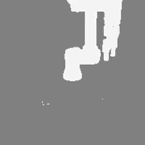
    </td>
    <td align="center">
      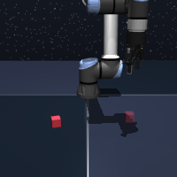
    </td>
  </tr>
</table>

<h2 align="center">Output video</h2>
<table>
  <tr>
    <td align="center">
      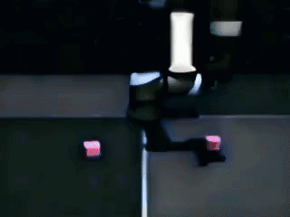
    </td>
    <td align="center">
      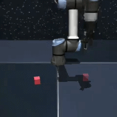
    </td>
  </tr>
</table>

- Built an inference pipeline conditioned on a **dynamic robot mask**, a first-frame reference image, and a text instruction.
- Converted UR5e manipulation trajectories into visual action controls for generating temporally consistent robot videos.
- Reproduced **480 × 480, 81-frame** video generation and evaluated fast-preview and standard 50-step denoising configurations.
- Stress-tested the model on complex and high-speed dexterous manipulation, revealing limitations in physical consistency, motion reasoning, and hallucination control.

`Video World Models` · `Diffusion Models` · `Masked Visual Actions` · `LoRA` · `Robot Manipulation` · `Wan2.2`

### 🦾 [LeWorldModel — Long-Horizon Robotic Manipulation](https://github.com/field-mx/LeWm_Saimo)

Extended a short-horizon **Joint-Embedding Predictive World Model (LeWM)** to long-horizon robotic cube grasping and transfer—without retraining the world model.

- Identified that final-goal latent distance is non-monotonic during long-horizon manipulation, causing the original CEM planner to become trapped in local optima.

  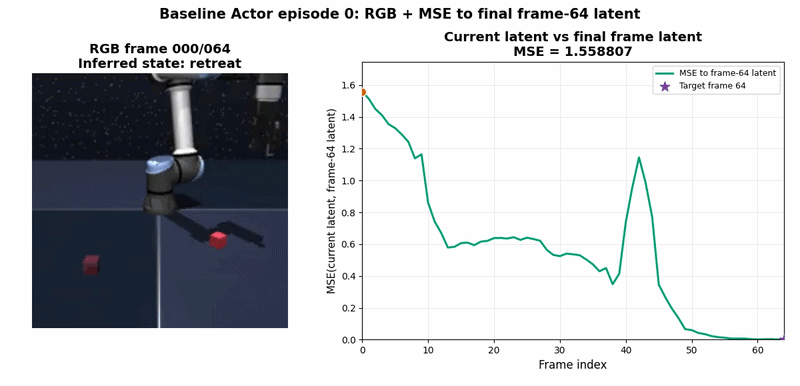

- Developed **Proprio V2**, combining a frozen LeWM with 6D robot proprioception, an `ALIGN → GRASP → TRANSFER` state machine, actor-guided MPC, value estimation, and uncertainty-aware candidate scoring.
- Built a closed-loop planner that evaluates 96 candidate action sequences and replans after every real action using only RGB observations and robot proprioception.
- Trained on 64 successful teacher trajectories (3,007 frames) and achieved **7/10 grasp-to-transfer confirmations** and **4/10 end-to-end task successes**, with **31.7 ms average LeWM inference time**.

<h2 align="center">Before</h2>

  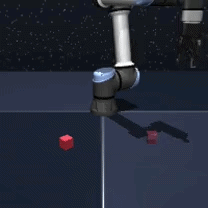

<h2 align="center">After</h2>

<table>
  <tr>
    <td align="center">
      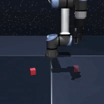
       
      <strong>Experiment 1</strong>
    </td>
    <td align="center">
      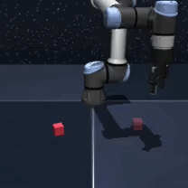
       
      <strong>Experiment 2</strong>
    </td>
    <td align="center">
      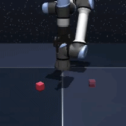
       
      <strong>Experiment 3</strong>
    </td>
    <td align="center">
      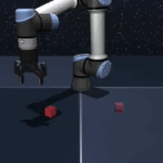
       
      <strong>Experiment 4</strong>
    </td>
    <td align="center">
      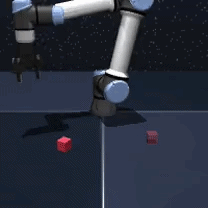
       
      <strong>Experiment 5</strong>
    </td>
  </tr>

  <tr>
    <td align="center">
      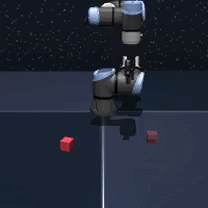
       
      <strong>Experiment 6</strong>
    </td>
    <td align="center">
      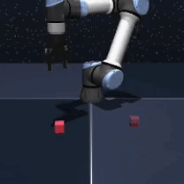
       
      <strong>Experiment 7</strong>
    </td>
    <td align="center">
      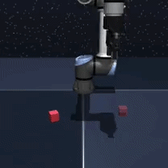
       
      <strong>Experiment 8</strong>
    </td>
    <td align="center">
      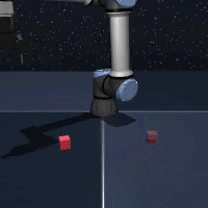
       
      <strong>Experiment 9</strong>
    </td>
    <td align="center">
      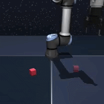
       
      <strong>Experiment 10</strong>
    </td>
  </tr>
</table>

`World Models` · `Model Predictive Control` · `Robot Manipulation` · `Joint-Embedding Prediction` · `MuJoCo` · `Python`

---

### [Industrial Hydrogen Digital Twin](https://github.com/field-mx/Sensor_Dashboard)

**Multi-sensor state estimation and health monitoring for industrial systems**

  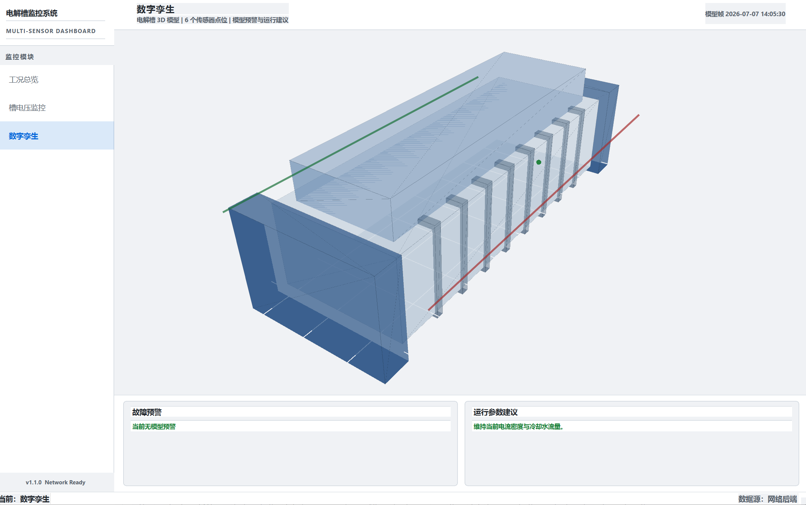
  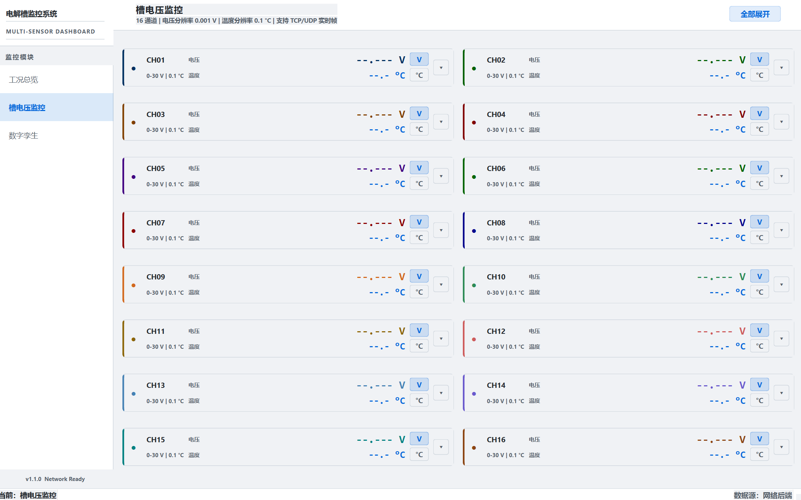
  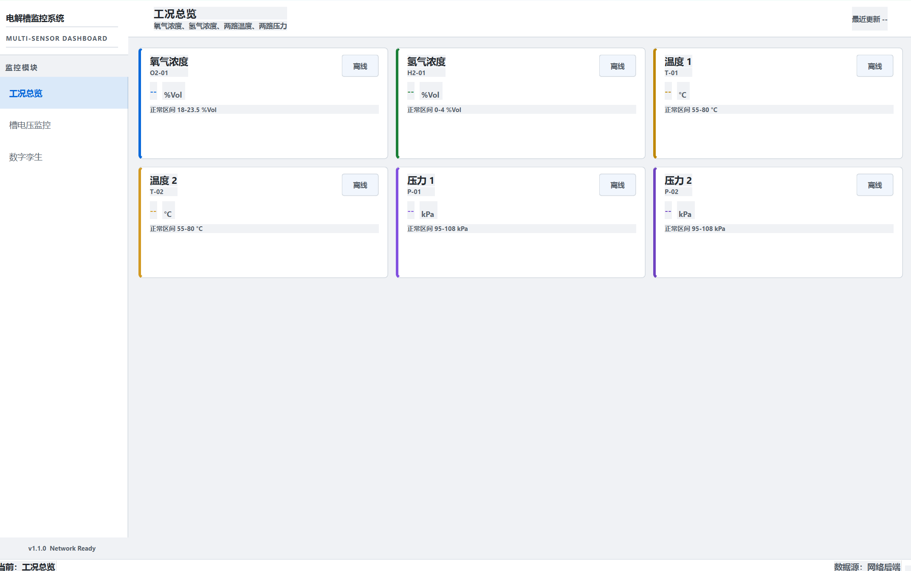
  

* Built a spatiotemporal prediction framework for a 61-channel industrial sensing system.
* Studied sparse sensing, full-state reconstruction, and multi-sensor signal completion.
* Designed early-warning logic based on residual analysis, trend monitoring, and health-state estimation.

---

### [Real-time EEG Three-class BCI System](https://github.com/field-mx/SE-EEGNet-Real-time-EEG-Three-Class-Classification-Model)

**Real-time EEG decoding and online control**

  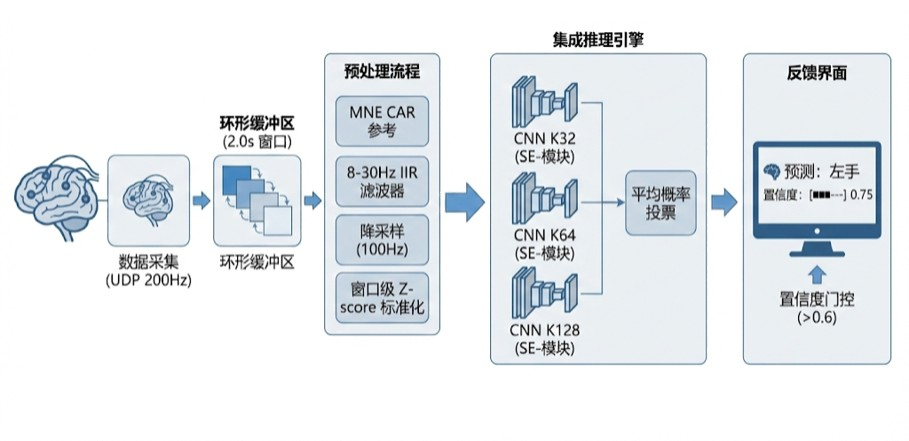

* Implemented a real-time EEG classification system based on SE-EEGNet.
* Focused on online preprocessing, motor imagery classification, and real-time inference.
* Integrated EEG decoding with device-side communication and control.

---

### [EEG Training System with Visual Feedback](https://github.com/field-mx/EEG_TrainingSystemwithVisualFeedback)

**Visual-feedback EEG training for motor imagery**

  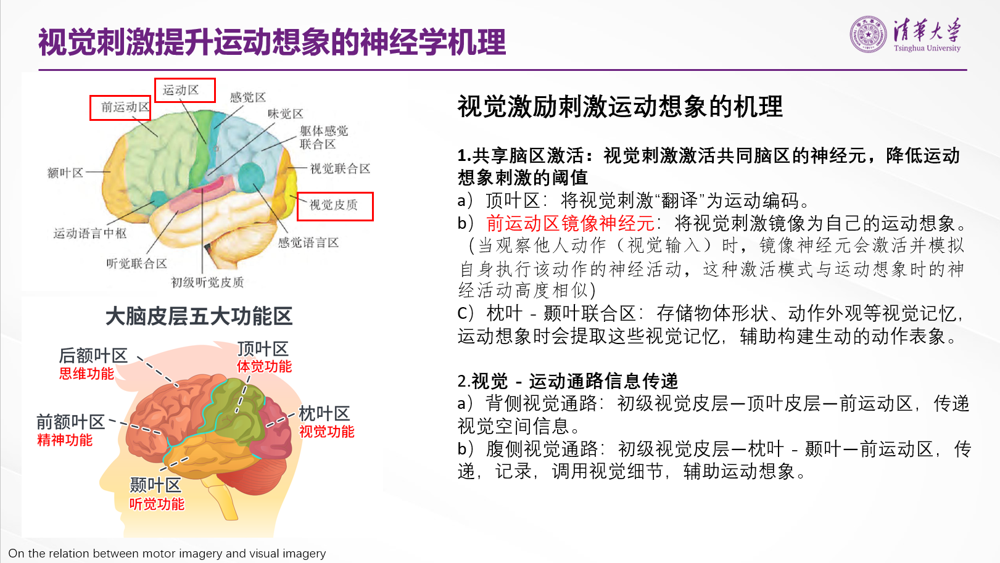
  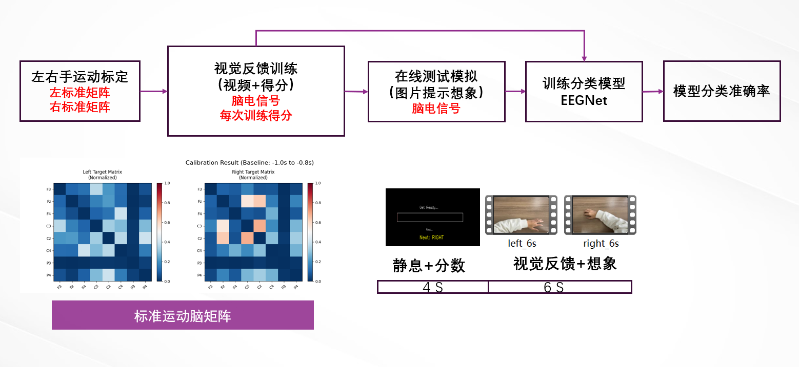

* Designed an EEG training platform with real-time visual feedback.
* Explored mirror-neuron-inspired interaction for motor imagery training.
* Implemented signal acquisition, feedback visualization, and user interaction modules.

---

### [Wearable Blood-flow Monitoring System](https://github.com/field-mx/Blood_flow_testing_instruments)

**Portable diffuse-speckle-based physiological sensing**

  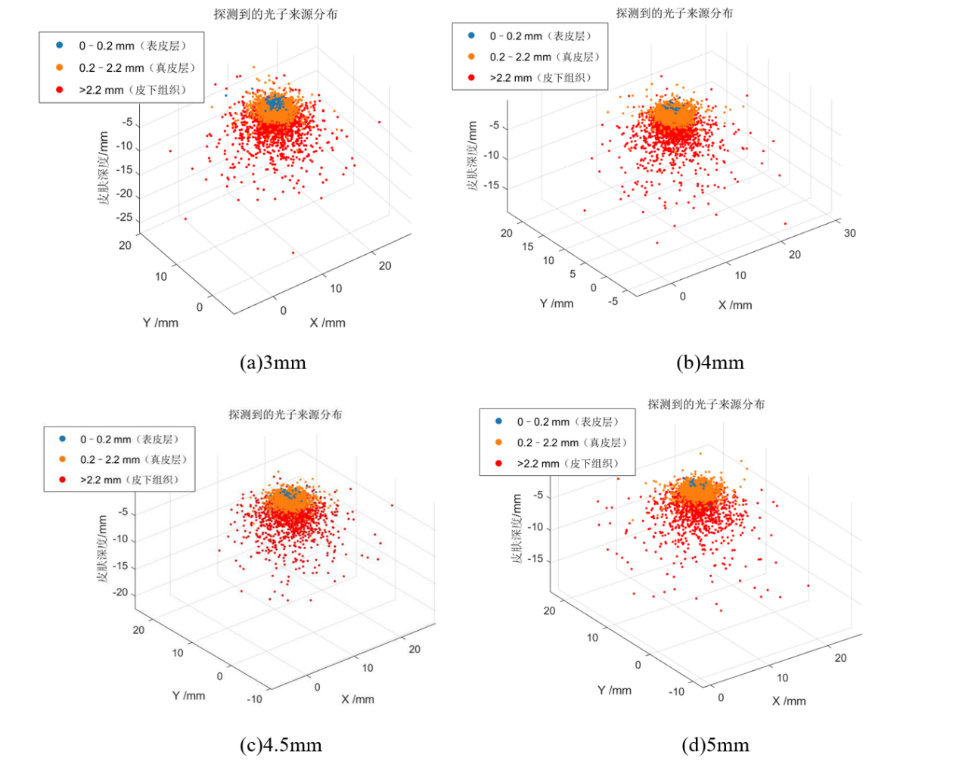
  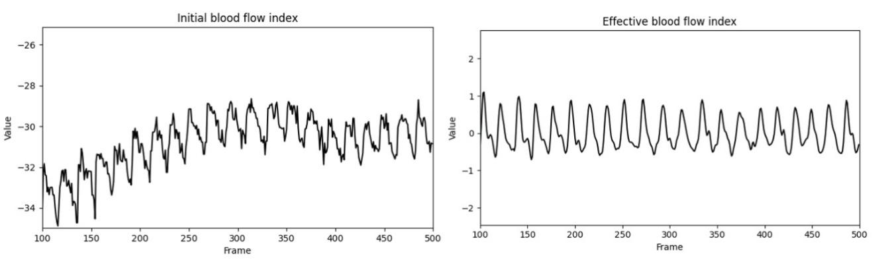
  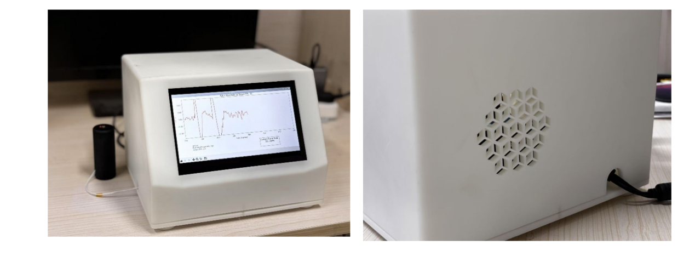

* Developed a wearable optical sensing system for blood-flow and pulse-wave monitoring.
* Implemented single-exposure pulse-wave extraction and multi-exposure flow-index estimation.
* Combined hardware design, signal processing, and simulation analysis for biomedical instrumentation.

---

### Visual-Tactile 3D Reconstruction

**Vision-based tactile sensing and deformation-field reconstruction**

* Developed a visual-tactile sensing system for reconstructing three-dimensional deformation fields.
* Built a measurement pipeline involving optical imaging, calibration, and deformation estimation.
* Focused on accurate tactile perception for intelligent sensing and robotic interaction.

---

### [Image Stitching System](https://github.com/field-mx/image_stitching)

**Panoramic sensing and image-processing pipeline**

* Implemented image segmentation, feature extraction, registration, and stitching.
* Applied the system to panoramic detection and inspection scenarios.

---

### [Remote Sensing CNN Classification](https://github.com/field-mx/CNN_image_classifications)

**CNN-based remote-sensing image classification**

* Built a CNN-based classification pipeline for remote-sensing image data.
* Implemented dataset preprocessing, model training, evaluation, and visualization.

---

## Technical Skills

**Programming:** Python, C/C++, MATLAB, Shell
**Machine Learning:** PyTorch, TensorFlow/Keras, scikit-learn
**Signal Processing:** time-series analysis, EEG processing, physiological signal processing, anomaly detection
**Computer Vision:** OpenCV, image stitching, CNN-based classification, visual measurement
**Systems & Tools:** Git, Linux, Conda, Raspberry Pi, socket communication, data acquisition systems
**Research Topics:** self-supervised learning, multimodal learning, digital twins, world models, physics-aware AI

---

## Current Focus

I am currently working on:

* lightweight world models for action-conditioned prediction
* physics-aware representation learning for sensing systems
* multi-sensor digital twins for industrial state estimation
* EEG/BCI systems for human intention and cognitive-state decoding
* wearable physiological sensing and biomedical instrumentation

---

## Long-term Direction

My long-term goal is to build **AI systems that connect physical measurement, scientific instrumentation, and intelligent decision-making**.

I am particularly interested in research problems where models are not only accurate, but also **physically grounded, interpretable, robust, and deployable in real-world sensing environments**.

---

## Contact

* GitHub: [@field-mx](https://github.com/field-mx)
* Institution: Tsinghua University
* Research interests: AI for sensors, digital twins, world models, EEG/BCI, biomedical sensing
