# Welcome to my Profile !

**AI for Sensing Systems · Digital Twins · World Models · Biomedical Signal Intelligence**

I am a graduate student at **Tsinghua University**, working at the intersection of **instrument science, artificial intelligence, signal processing, and intelligent sensing systems**.

My interests lie in developing AI models that can understand, reconstruct, and predict complex physical and biological signals, with applications in industrial digital twins, world models, EEG/BCI systems, wearable sensing, and scientific instrumentation.

---

## Research Interests

* **Physical AI & IWorld Models**

  Committed to integrating the real physical world into AI, promoting the creation of a learnable, reusable, and evolvable digital world, and helping AGI arrive sooner!

* **Digital Twins & Multi-sensor Modeling**

  Sparse sensing, spatiotemporal reconstruction, anomaly detection, health-state estimation, and industrial system modeling.

* **EEG / BCI & Human-state Decoding**

  Motor imagery classification, real-time EEG processing, cognitive-state modeling, and neural feedback systems.


* **Biomedical & Wearable Sensing**

  Optical blood-flow monitoring, pulse-wave extraction, physiological signal processing, and portable sensing instruments.


* **Computer Vision for Measurement Systems**

  Image stitching, visual inspection, remote-sensing image classification, and vision-based sensing platforms.


---

## Selected Projects


### 🦾 [LeWorldModel — Long-Horizon Robotic Manipulation](https://github.com/field-mx/LeWm_Saimo)

Extended a short-horizon **Joint-Embedding Predictive World Model (LeWM)** to long-horizon robotic cube grasping and transfer—without retraining the world model.

- Identified that final-goal latent distance is non-monotonic during long-horizon manipulation, causing the original CEM planner to become trapped in local optima.
<p align="center">
  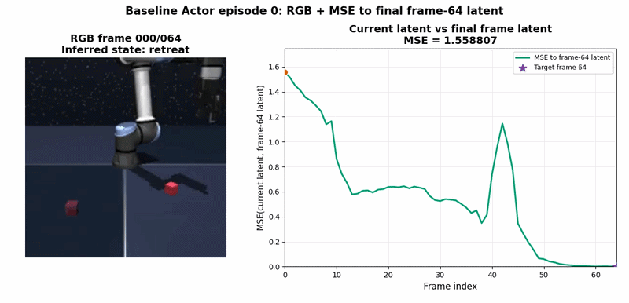
</p>

- Developed **Proprio V2**, combining a frozen LeWM with 6D robot proprioception, an `ALIGN → GRASP → TRANSFER` state machine, actor-guided MPC, value estimation, and uncertainty-aware candidate scoring.
- Built a closed-loop planner that evaluates 96 candidate action sequences and replans after every real action using only RGB observations and robot proprioception.
- Trained on 64 successful teacher trajectories (3,007 frames) and achieved **7/10 grasp-to-transfer confirmations** and **4/10 end-to-end task successes**, with **31.7 ms average LeWM inference time**.

<h2 align="center">Before</h2>
<p align="center">
  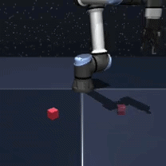
</p>

<h2 align="center">After</h2>

<table>
  <tr>
    <td align="center">
      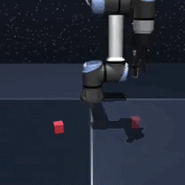
      <br>
      <strong>Experiment 1</strong>
    </td>
    <td align="center">
      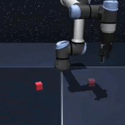
      <br>
      <strong>Experiment 2</strong>
    </td>
    <td align="center">
      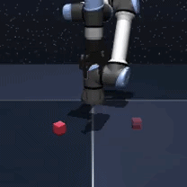
      <br>
      <strong>Experiment 3</strong>
    </td>
    <td align="center">
      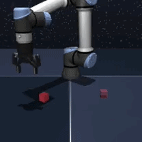
      <br>
      <strong>Experiment 4</strong>
    </td>
    <td align="center">
      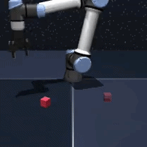
      <br>
      <strong>Experiment 5</strong>
    </td>
  </tr>

  <tr>
    <td align="center">
      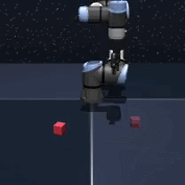
      <br>
      <strong>Experiment 6</strong>
    </td>
    <td align="center">
      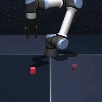
      <br>
      <strong>Experiment 7</strong>
    </td>
    <td align="center">
      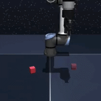
      <br>
      <strong>Experiment 8</strong>
    </td>
    <td align="center">
      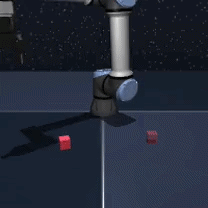
      <br>
      <strong>Experiment 9</strong>
    </td>
    <td align="center">
      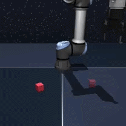
      <br>
      <strong>Experiment 10</strong>
    </td>
  </tr>
</table>


`World Models` · `Model Predictive Control` · `Robot Manipulation` · `Joint-Embedding Prediction` · `MuJoCo` · `Python`

---

### 🎬 [Masked Visual Actions — Robot Video Generation](https://github.com/field-mx/masked-visual-actions)

Reproduced the **Masked Visual Actions** robot video generation pipeline using **Wan2.2-Fun-A14B-Control**, dual LoRA adapters, and robot trajectories generated from LeWM/OGBench.
<h2 align="center">Input image and masked video</h2>
<table>
  <tr>
    <td align="center">
      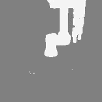
    </td>
    <td align="center">
      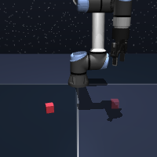
    </td>
  </tr>
</table>

<h2 align="center">Output video</h2>
<table>
  <tr>
    <td align="center">
      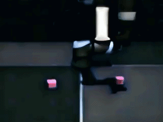
    </td>
    <td align="center">
      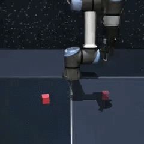
    </td>
  </tr>
</table>

- Built an inference pipeline conditioned on a **dynamic robot mask**, a first-frame reference image, and a text instruction.
- Converted UR5e manipulation trajectories into visual action controls for generating temporally consistent robot videos.
- Reproduced **480 × 480, 81-frame** video generation and evaluated fast-preview and standard 50-step denoising configurations.
- Stress-tested the model on complex and high-speed dexterous manipulation, revealing limitations in physical consistency, motion reasoning, and hallucination control.

`Video World Models` · `Diffusion Models` · `Masked Visual Actions` · `LoRA` · `Robot Manipulation` · `Wan2.2`

---

### [PhysicsRelationCTF — Physics-Guided Forecasting for Electrolyzer Monitoring](https://github.com/field-mx/PhysicsRelationCTF)

**From sensor measurements to future operating trends: forecasting support for fault early warning.**

Industrial electrolyzers generate coupled electrical, thermal, pressure, flow, and gas-composition signals. Forecasting these signals can provide advance information for anomaly assessment and fault early warning, but complete equipment parameters and dynamic equations are often unavailable. This project asks how the physical knowledge that is available can still improve prediction.

Developed **PhysicsRelationCTF (PRCTF)**, which enhances **ChannelTokenFormer (CTF)** through two complementary interfaces while retaining its masked attention and channel-token decoder:

- **Structural guidance:** map sparse, directed physical relationships to channel-attention biases, guiding information exchange while preserving data-driven learning of unknown dependencies.
- **Equation-informed content:** compute reference features from historical measurements, such as electrical power and Faradaic gas-generation references, and inject their encoded messages into attention aggregation. Data-driven attention and a lightweight residual branch learn unmodeled dynamics.

<p align="center">
  <a href="https://github.com/field-mx/PhysicsRelationCTF">
    
  </a>
</p>

**Industrial task:** use **96 seconds of history to forecast the next 96 seconds across 56 monitoring channels**. The paper compares PRCTF with four forecasting baselines on the industrial alkaline-electrolyzer dataset:

| Model | MSE Mean | MSE Best | MAE Mean | MAE Best | Recorded training time (s) |
|---|---:|---:|---:|---:|---:|
| Original CTF | 0.10901 | 0.10859 | 0.10809 | 0.10796 | 514.1 |
| MTGNN | 0.11012 | 0.10974 | 0.10800 | 0.10701 | 182.2 |
| PatchTST | 0.11145 | 0.11076 | 0.11124 | 0.11022 | 89.2 |
| PhyGNN adapted | 0.14649 | 0.14365 | 0.18030 | 0.17610 | **69.8** |
| **PRCTF (ours)** | **0.10858** | **0.10773** | **0.10776** | **0.10695** | 615.2 |

**PRCTF achieves the lowest mean and best MSE/MAE among these five evaluated configurations.** Mean MSE is **0.393% lower than Original CTF, 1.398% lower than MTGNN, and 2.571% lower than PatchTST**.

*MSE and MAE are normalized. Mean averages the three fixed seeds (42, 43, 44); Best is the minimum for each metric and need not come from the same seed. PhyGNN is adapted for forecasting rather than reproduced in its original task. Training times are archived averages, not a controlled hardware-efficiency benchmark. These original-data paper results are separate from the low-pass curve illustrations below.*


**Deployment:** released trained reference weights, fitted normalization/calibration, and CPU/CUDA inference tools for all three systems. The implementation returns forecasts in physical measurement units without requiring retraining.

**Figure 1 — Single-origin forecasts during selected dynamic changes**

Electrolyzer records contain extended relatively steady portions, where model outputs can be similar. To examine local differences beyond aggregate MSE, the figure compares four selected intervals from three channels: hydrogen outlet flow, hydrogen-side stack outlet temperature 1, and hydrogen-minus-oxygen separator level. Operating-state labels are unavailable, so these are observed dynamic changes rather than confirmed regime switches.

<p align="center">
  <a href="https://github.com/field-mx/PhysicsRelationCTF/blob/main/figures/industrial/selected_dynamic_intervals.pdf">
    
  </a>
</p>

Both models receive the same **96 s history** and issue one complete **96 s forecast**, without within-horizon updates, overlap averaging, curve shifts or additional output smoothing. Gray shading marks the observed history.

In these selected intervals, **PRCTF reduces MSE by 62.43–88.79% and TDI by 36.16–91.85%**. The two temperature intervals show TDI reductions of 91.85% and 88.26%. **TDI (Temporal Distortion Index)** measures temporal mismatch along the optimal DTW alignment path; lower values indicate better timing, rather than a delay measured in seconds:

```math
\mathrm{TDI}=\frac{1}{H^2}\sum_{(i,j)\in\pi^\ast}(i-j)^2,\qquad H=96.
```

| Panel / channel | Forecast interval (s) | CTF MSE | PRCTF MSE | MSE reduction | CTF TDI | PRCTF TDI | TDI reduction |
|---|---|---:|---:|---:|---:|---:|---:|
| (a) Hydrogen outlet flow | [96, 192) | 4845.62 | **1236.08** | **74.49%** | 12.3120 | **7.8606** | **36.16%** |
| (b) Hydrogen-side stack outlet temperature 1 | [1824, 1920) | 0.021868 | **0.002451** | **88.79%** | 14.2852 | **1.1644** | **91.85%** |
| (c) Hydrogen-side stack outlet temperature 1 | [1920, 2016) | 0.038945 | **0.008597** | **77.92%** | 28.9741 | **3.4002** | **88.26%** |
| (d) Hydrogen-minus-oxygen separator level | [192, 288) | 0.501295 | **0.188319** | **62.43%** | 2.7002 | **1.5739** | **41.71%** |

[Local interval metrics](https://github.com/field-mx/PhysicsRelationCTF/blob/main/results/selected_dynamic_intervals.csv). Reductions are `(CTF error − PRCTF error) / CTF error × 100%`.

MSE uses `(m³/h)²`, `°C²` and `mm²` for the respective channels; positive reductions mean lower PRCTF error. These are post hoc illustrative cases, not an event-wide benchmark. Aggregate performance is evaluated by the three-seed results above; component comparisons separately assess the physical interfaces. [TDI reference](https://papers.nips.cc/paper_files/paper/2019/hash/466accbac9a66b805ba50e42ad715740-Abstract.html).

**Figure 2 — PRCTF rolling prediction as an application example**

<p align="center">
  <a href="https://github.com/field-mx/PhysicsRelationCTF/blob/main/figures/industrial/rolling_prediction_application.pdf">
    
  </a>
</p>

PRCTF uses **96 s of history to forecast 96 s**, updates every **12 s**, and combines all lead-1–96 s forecasts covering each timestamp using validation-error weights shared with CTF. A second-order causal Butterworth filter (**0.05 Hz cutoff, 1 Hz sampling**) is then applied to the fused PRCTF output. The figure shows **test seconds 0–2880**, not the entire 4847-point test set. Gray/yellow boxes and labels (a)–(d) locate the corresponding cases in Figure 1; rolling updates continue outside those boxes.

This second figure illustrates continuous operation with updating and postprocessing, **not superiority over CTF or fixed-96-second-ahead accuracy**. The metrics in the table refer only to Figure 1.

*Both figures use a separate seed-42 experiment whose Train/Validation/Test observations were already causally low-pass filtered. Only Figure 2 adds output filtering. These illustrations are distinct from the original-data three-seed benchmark and released reference weights.*

**All-channel attachment:** [View / download the 56-page observations-and-PRCTF PDF](https://github.com/field-mx/PhysicsRelationCTF/blob/main/figures/industrial/all_56_channels_truth_PRCTF_full_test.pdf). One channel per page, with the complete filtered test timeline. The attachment uses **24 s rolling updates and validation-weighted overlap over leads 1–96 s**; only filtered observations and PRCTF are plotted. This policy differs from the two examples above.

[Code & Results](https://github.com/field-mx/PhysicsRelationCTF) · [Pretrained Weights](https://github.com/field-mx/PhysicsRelationCTF/tree/main/weights) · [Deployment Guide](https://github.com/field-mx/PhysicsRelationCTF/blob/main/weights/README.md)

**Paper / Preprint:** Public link to be added.
<!-- PRCTF_PAPER_LINK: Replace the placeholder above with [Paper](PUBLIC_PAPER_URL) when the manuscript is publicly available. -->

`Physics-Guided AI` · `Multivariate Forecasting` · `Channel Attention` · `Industrial Sensors` · `PyTorch`

---

### [Electrolyzer AI Monitoring — Desktop UI & On-device Model Orchestration](https://github.com/field-mx/Sensor_Dashboard)

**Designing the monitoring front end and the local model workflow, from measurements to forecasts and model updates.**

Built a **PyQt6 desktop application** that connects multi-sensor data, an interactive 3D equipment view, rolling forecasts, and residual alerts. A **FastAPI + PyTorch** backend runs inference and fine-tuning on the user's Windows PC using CPU.

- **Monitoring interface design:** coordinated process overview, trend/forecast plots, 3D structure, and model-update views; measurement selection links the table to its curve, with external plot legends and visible service, version, and task states. The current 3D scene is schematic; sensor coordinates remain uncalibrated.
- **Asynchronous model integration:** call the local model service without blocking the UI; align 96-second histories with the next 96 forecast points across 56 channels, handle timeouts and reconnection, and discard stale responses after a reset or version change.
- **On-device resource scheduling:** serialize model access, run fine-tuning in a separate worker process, and share a lock between manual and daily jobs. Inference pauses during training while the interface remains responsive.
- **Model lifecycle:** validate imported normal Excel, partition windows chronologically, show real training progress/loss, evaluate candidates, then activate or roll back. Daily training is optional, persistent, and deduplicates previously processed data; it does not automatically activate candidates.
- **Deployment and interaction:** provide `Setup.cmd` and `StartDemo.cmd` for the complete offline delivery, plus play/pause/reset/speed controls, residual-based upward/downward fault demonstrations, and event-history export.

<p align="center">
  
</p>

<p align="center">
  
</p>

*The presentation replays Excel history to simulate live acquisition; inference and residual alerts execute locally. The forecasting algorithm and released weights are maintained separately in [PhysicsRelationCTF](https://github.com/field-mx/PhysicsRelationCTF).*

[Project & setup](https://github.com/field-mx/Sensor_Dashboard) · [English README](https://github.com/field-mx/Sensor_Dashboard/blob/main/README.en.md) · [Operation guide](https://github.com/field-mx/Sensor_Dashboard/blob/main/docs/操作指南.md)

`Desktop UI Design` · `PyQt6` · `pyqtgraph/OpenGL` · `FastAPI` · `PyTorch` · `On-device AI` · `Model Orchestration` · `Time-series Forecasting`

---

### [Real-time EEG Three-class BCI System](https://github.com/field-mx/SE-EEGNet-Real-time-EEG-Three-Class-Classification-Model)

**Real-time EEG decoding and online control**
<p align="center">
  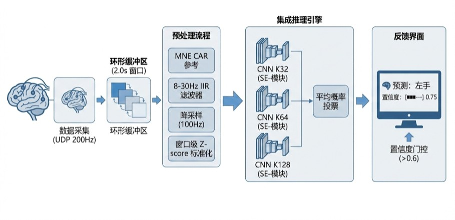
</p>


* Implemented a real-time EEG classification system based on SE-EEGNet.
* Focused on online preprocessing, motor imagery classification, and real-time inference.
* Integrated EEG decoding with device-side communication and control.

---

### [EEG Training System with Visual Feedback](https://github.com/field-mx/EEG_TrainingSystemwithVisualFeedback)

**Visual-feedback EEG training for motor imagery**
<p align="center">
  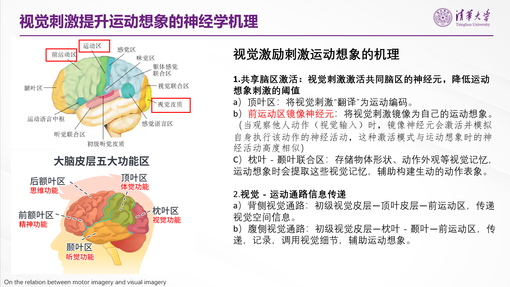
  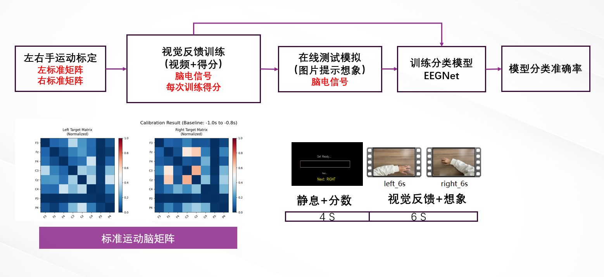
</p>

* Designed an EEG training platform with real-time visual feedback.
* Explored mirror-neuron-inspired interaction for motor imagery training.
* Implemented signal acquisition, feedback visualization, and user interaction modules.

---

### [Wearable Blood-flow Monitoring System](https://github.com/field-mx/Blood_flow_testing_instruments)

**Portable diffuse-speckle-based physiological sensing**
<p align="center">
  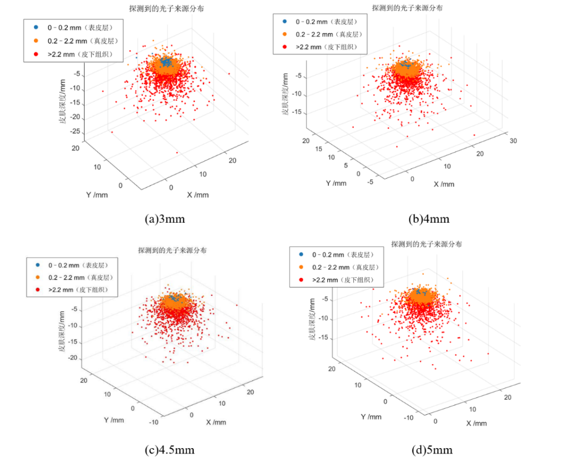
  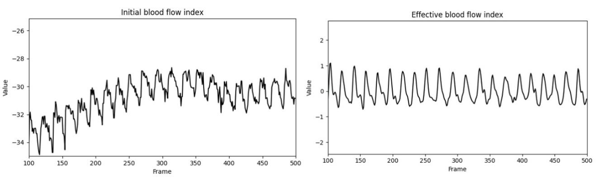
  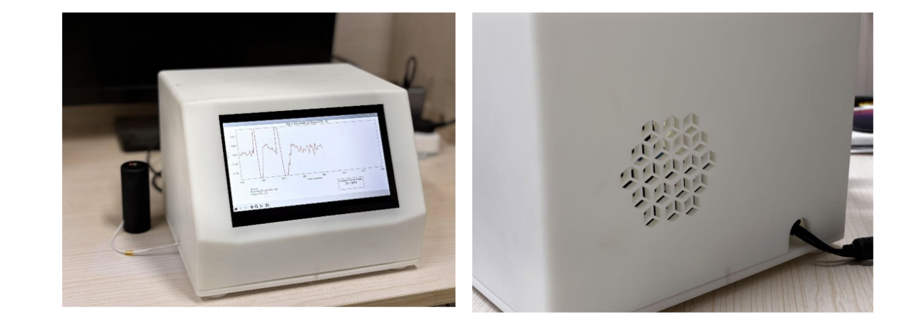
</p>

* Developed a wearable optical sensing system for blood-flow and pulse-wave monitoring.
* Implemented single-exposure pulse-wave extraction and multi-exposure flow-index estimation.
* Combined hardware design, signal processing, and simulation analysis for biomedical instrumentation.

---

### Visual-Tactile 3D Reconstruction

**Vision-based tactile sensing and deformation-field reconstruction**

* Developed a visual-tactile sensing system for reconstructing three-dimensional deformation fields.
* Built a measurement pipeline involving optical imaging, calibration, and deformation estimation.
* Focused on accurate tactile perception for intelligent sensing and robotic interaction.

---

### [Image Stitching System](https://github.com/field-mx/image_stitching)

**Panoramic sensing and image-processing pipeline**

* Implemented image segmentation, feature extraction, registration, and stitching.
* Applied the system to panoramic detection and inspection scenarios.

---

### [Remote Sensing CNN Classification](https://github.com/field-mx/CNN_image_classifications)

**CNN-based remote-sensing image classification**

* Built a CNN-based classification pipeline for remote-sensing image data.
* Implemented dataset preprocessing, model training, evaluation, and visualization.

---

## Technical Skills

**Programming:** Python, C/C++, MATLAB, Shell
**Machine Learning:** PyTorch, TensorFlow/Keras, scikit-learn
**Signal Processing:** time-series analysis, EEG processing, physiological signal processing, anomaly detection
**Computer Vision:** OpenCV, image stitching, CNN-based classification, visual measurement
**Systems & Tools:** Git, Linux, Conda, Raspberry Pi, socket communication, data acquisition systems
**Research Topics:** self-supervised learning, multimodal learning, digital twins, world models, physics-aware AI

---

## Current Focus

I am currently working on:

* lightweight world models for action-conditioned prediction
* physics-aware representation learning for sensing systems
* multi-sensor digital twins for industrial state estimation
* EEG/BCI systems for human intention and cognitive-state decoding
* wearable physiological sensing and biomedical instrumentation

---

## Long-term Direction

My long-term goal is to build **AI systems that connect physical measurement, scientific instrumentation, and intelligent decision-making**.

I am particularly interested in research problems where models are not only accurate, but also **physically grounded, interpretable, robust, and deployable in real-world sensing environments**.

---

## Contact

* GitHub: [@field-mx](https://github.com/field-mx)
* Institution: Tsinghua University
* Research interests: AI for sensors, digital twins, world models, EEG/BCI, biomedical sensing
